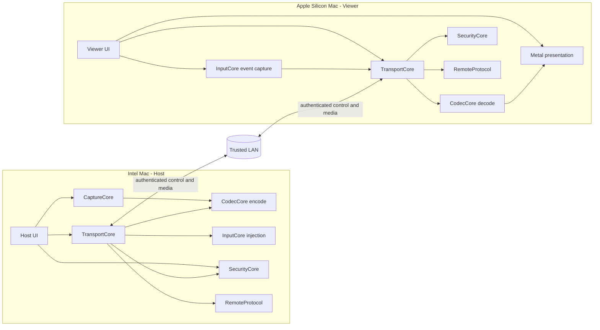
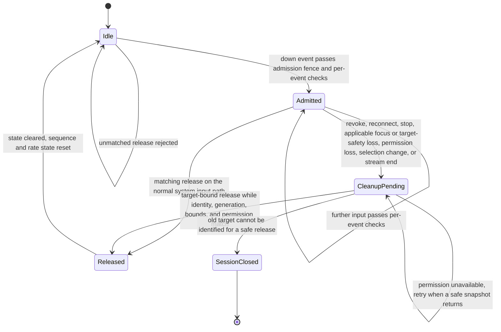

# MacRemoteApp Architecture

The [P6 Host-controlled input contract](P6_BACKGROUND_CONTROL.md) is an
explicit negotiated extension to the foreground input path. Host acceptance
of the authenticated Viewer pairing provides durable input trust for
input, subject to the P6 target, permission, secure-input, session, and
generation checks. Every ordinary input path requires the selected app to be
foreground. Explicit selection may activate its regular app before control;
background viewing remains available while input is disabled. P6 does not
provide inactive-process or locked-screen control. Session pause closes
control; unpairing removes trust and ends the active session.

## Architecture intent

MacRemoteApp is a two-application system with shared, platform-aware packages.
The architecture keeps capture, codec, transport, input, security, and wire
protocol concerns separate so that the Host and Viewer can evolve without
turning into one coupled remote-desktop process.

The architecture is intentionally limited to the V1 goal: one authenticated
Viewer, one selected Host window, LAN transport, low-latency video, input, and
text clipboard. It does not design an Internet relay, WebRTC, audio pipeline,
file transfer, or multi-window control path.

Post-V1 capability proposals and their security/ownership gates are recorded
in `docs/POST_V1_ROADMAP.md`; they are not architecture commitments for M10.

## Logical topology



The diagram is logical, not a requirement that every package be a separate
process. Host and Viewer are the process boundaries; shared packages are
library/module boundaries.

## Repository structure

```text
MacRemoteApp/
├── Apps/
│   ├── Host/
│   └── Viewer/
├── Packages/
│   ├── AppSupport/
│   ├── RemoteProtocol/
│   ├── CaptureCore/
│   ├── CodecCore/
│   ├── TransportCore/
│   ├── InputCore/
│   └── SecurityCore/
├── Tests/
└── docs/
```

M0 may create a minimal variation of this layout if the selected Swift/Xcode
project format needs it, but any variation must preserve the package
responsibilities and dependency direction below.

## Component responsibilities

| Component | Owns | Does not own |
| --- | --- | --- |
| `Apps/Host` | Host UI, lifecycle, permission education, window-selection UX, pairing-trust/capability composition, and Host clipboard bridge | Wire framing, codec internals, generic transport policy |
| `Apps/Viewer` | Viewer UI, discovery/session UX, stream surface, input surface, and explicit local clipboard opt-in | Host capture, Accessibility injection, trust-store internals |
| `AppSupport` | Native AppKit menu construction, reusable settings content/window presentation, bundle version/build formatting | Session ownership, permission requests, Keychain access, transport, capture, input authorization |
| `RemoteProtocol` | Versioned wire messages, frame envelope, serialization/deserialization, capability identifiers, validation limits | Sockets, UI, ScreenCaptureKit, VideoToolbox, Keychain |
| `CaptureCore` | Host-side application/window enumeration, selected offscreen/active-window revalidation, ScreenCaptureKit capture orchestration, bounded liveness/restart state, timestamps, capture state | H.264 bitstream policy, network I/O, remote input |
| `CodecCore` | VideoToolbox compression/decompression adapters, codec configuration, frame metadata, decode output contract | Window selection, transport, user permissions |
| `TransportCore` | Bonjour discovery, Network.framework connections, channel lifecycle, framing delivery, bounded queues, flow control, reconnect state, and session authorization delivery gates | Product UI, pairing policy, capture, event injection, current macOS permission/focus truth |
| `InputCore` | Platform-neutral input model, Viewer event normalization, Host coordinate mapping, permission-aware injection adapter contract and final injection-time safety check | Wire serialization, trust decisions, arbitrary background control |
| `SecurityCore` | Device identity, Keychain trust records, pairing state, peer authentication policy, reusable trust/capability policy evaluation, redaction helpers | UI prompts, sockets, window selection, current window/permission/focus state, generic business workflow |

## Dependency direction

The intended dependency direction is:

```text
Apps/Host ───────┐
Apps/Viewer ─────┼──> RemoteProtocol
                 ├──> TransportCore ───> RemoteProtocol
                 ├──> SecurityCore
                 ├──> InputCore
                 ├──> CodecCore
                 ├──> CaptureCore (Host only)
                 └──> AppSupport (app-layer UI only)
```

Additional rules:

- `RemoteProtocol` is the lowest-level shared contract and should remain
  independent of AppKit and platform UI.
- `CodecCore`, `CaptureCore`, and `InputCore` may expose protocols for test
  doubles, but they must not reach into each other's concrete implementations.
- `TransportCore` depends on protocol definitions and security/session
  decisions, but `SecurityCore` must not depend on an active socket.
- App modules translate package events into UI state; package modules do not
  import app view controllers.
- `AppSupport` is a leaf UI package used by the two app targets. It imports
  AppKit/Foundation, not the protocol, session, or security packages. Core
  packages do not depend on it. App-owned callbacks connect menu/settings
  actions to existing runtime operations.
- `SecurityCore` evaluates identity, pairing consent, trust, and capability
  policy inputs but does not own session-specific window generations or OS
  permission/focus state.
- `TransportCore` is the authoritative session-delivery gate: after TLS and
  pairing policy are satisfied, it stores the current authorization record and
  checks message direction, negotiated capability, session generation, and
  selected-window generation before sending or accepting protected messages.
  It clears that record before teardown or revoke notification and fails closed
  if notification delivery fails.
- `Apps/Host` supplies the selected-window and permission/focus facts.
  `InputCore.HostInputController` performs the final check immediately before
  every Host-side injection; a TransportCore authorization decision alone
  never authorizes an OS event.
- M7 keeps clipboard policy split at the same boundary: `RemoteProtocol` owns
  the bounded Offer/Text/Acknowledgement wire schemas; `TransportCore` owns the
  pure `ClipboardSyncCoordinator` transient state machine and the redacted
  `SessionUXProjection`; `Apps/Host` and `Apps/Viewer` are the only layers that
  read/write `NSPasteboard` and render the opt-in/session status. Clipboard
  AppKit bridges must still call `SessionCoordinator.send`, so
  `TransportCore` remains the authoritative authentication, authorization, and
  capability enforcement point.
- In M3, `CaptureCore` is the source of truth for the Host window catalog,
  Screen Recording permission state, selected-window generation, and raw
  timestamped pixel-buffer lifecycle. `Apps/Host` may map those values to
  `RemoteProtocol` messages after TransportCore authorization; CaptureCore
  itself does not import the wire package.
- In M5, `Apps/Viewer/ViewerInputSurface` owns AppKit event capture and visible
  readiness state. `InputCore` owns the platform-neutral event record,
  coordinate normalization, sequence, and rate/size validation. The Viewer
  maps that record to `RemoteProtocol.InputEventMessage` through
  `ViewerInputTransport`, and `TransportCore.SessionCoordinator` is the
  authenticated capability/window-generation delivery gate. No M5 component
  calls CoreGraphics or Accessibility APIs.
- In M6, `Apps/Host` owns the input-message bridge and per-session input loop,
  `InputCore.HostInputController` performs the final per-event check, and the
  typed `CoreGraphicsAccessibilityInputAdapter` is the only M6 code that
  constructs/posts `CGEvent` values. The admission and held-input cleanup
  rules are specified as a state machine in
  [Host input admission and cleanup](#host-input-admission-and-cleanup).
- In M10, `Apps/Host/HostRuntime` composes first-run permission onboarding, the
  listener, `CaptureCore`,
  `CodecCore`, `InputCore`, clipboard bridges, and `SessionCoordinator` for
  one authenticated Viewer. `Apps/Viewer/ViewerRuntime` composes Bonjour
  discovery, the authenticated session, H.264 decode, Metal presentation, the
  Viewer input surface, pairing prompts, and clipboard bridge. The normal
  pilot uses TLS bootstrap plus a `SecurityCore.PairingCoordinator` backed by
  the Keychain trust store; the Host owns the consent alert and the Viewer
  owns a code-comparison consent prompt with explicit Accept/Deny actions.
  After successful pairing, Host reuses that trust as durable input
  authorization and enables negotiated text clipboard on reconnect without a
  second Host prompt. Viewer still requires its session-local clipboard
  opt-in. Unpairing removes trust and closes the active session.
  `MACREMOTEAPP_PEER_CERT` remains an
  optional pinned-peer migration/diagnostic input, not a new-installation
  requirement. The Host remains authoritative by validating eligibility and
  generation before authorization. During an active session it refreshes the
  eligible-window catalog so the Viewer can replace the selected app without
  reconnecting. On macOS 14 or later, a direct Viewer selection activates
  Host, confirms Host is frontmost, and cooperatively yields activation to
  that regular app for all peers. It may use the public Accessibility
  raise action for the exact selected target when the Host already has
  Accessibility trust and can match its geometry unambiguously. Legacy input
  requires the exact target live and the active PID plus top regular layer-0
  window to identify that app. Negotiated P6 adds Host pairing, control
  generation, and the same optional global secure-input signal as legacy
  foreground input. Target-process Accessibility inspection is used only to
  classify an inactive selected target for safe cleanup; it does not impose an
  additional foreground gate or authorize inactive-process input.
  CaptureCore resolves selected windows from the full ScreenCaptureKit
  catalog, and the picker offers titled offscreen windows of regular apps as
  well as on-screen targets. Explicit selection requests a bounded reveal and
  activation before capture; this does not grant input authority. A transient
  catalog snapshot that omits the active selection is withheld from Viewer;
  three consecutive CaptureCore liveness misses are required before target
  loss, and an unexpected stream end gets at most two delayed restarts after
  the same window ID, bundle ID, PID, layer, and geometry are revalidated.
  This keeps video lifecycle independent from input authorization and does not
  change RemoteProtocol.
  The Viewer
  shows explicit Connecting, Connected, and Reconnecting states and disables
  duplicate Connect actions while a session is active. Host and Viewer send
  their bounded short hostnames in the optional `Hello.deviceName` display
  field; a Host rename is reflected in that field, and it never affects trust.
  The Host remains resident when TCC or
  Bonjour setup is denied: `HostRuntimeStatus` is projected into the status
  menu and an explicit Retry action re-runs setup. Physical cross-hardware
  evidence remains the open M10 acceptance gate.
- M10 also exposes trust recovery in the app layer without moving trust
  storage out of `SecurityCore`: the Host status menu and Viewer window can
  explicitly forget all saved peer records. The app stops the active session
  before asking the Keychain-backed `TrustStore` to revoke those records; the
  local device identity, permissions, and capture settings remain intact. The
  Host status menu also edits a bounded, UserDefaults-backed Bonjour instance
  name. That name is discovery metadata visible on the LAN, never a TLS or
  pairing identity, and changing it restarts only the listener.
- M10 startup ordering is intentional: `Apps/Host` enrolls the local
  Keychain-backed identity and completes the Screen Recording setup before it
  waits for Bonjour listener readiness. Starting Bonjour is the Local Network
  consent trigger; listener readiness requires both the Network.framework
  socket-ready state and the configured service-registration callback. A
  timeout or policy denial is surfaced as a Local Network recovery state.
  `Apps/Viewer` enrolls its own identity before starting discovery, reports
  discovery error categories, and requires the operator to choose a Host
  before connecting. Neither app treats a permission grant as pairing: the
  first connection still requires Host consent and explicit Viewer acceptance
  after comparing the independently derived code; only both consents commit
  the peer trust records.
- Authorization enforcement is deliberately split by responsibility:
  `SecurityCore` owns identity, trust records, pairing consent, and peer
  identity validation; `TransportCore.SessionCoordinator` owns the
  authenticated session authorization epoch, capability/window-generation
  delivery gate, and protected-message invalidation; `InputCore.HostInputController`
  performs the final per-event permission, focus, target-identity, and current
  geometry checks. `Apps/Host/HostRuntime` composes these gates and never
  replaces them with UI state.
- The physical M2 diagnostic orchestration remains in `Apps/Host` and
  `Apps/Viewer`; `TransportCore` only exposes the Bonjour/TLS/session APIs.
  `SecurityCore` derives the presented peer identity from the TLS public key
  and persists only the trusted peer record. Each app loads or locally enrolls
  its own P-256 private key and certificate in Keychain, then assembles the
  `SecIdentity` used by Network.framework. The debug-only PKCS#12 provisioning
  path remains for physical smoke diagnostics. No peer private key is
  exchanged; the optional public-certificate path is retained only for pinned
  migration and diagnostics.
- The M10 production composition uses separate Keychain namespaces for the
  two roles: Host identity label `MacRemoteApp.host` and trust service
  `com.rudinyu.MacRemoteApp.Host.trust`; Viewer identity label
  `MacRemoteApp.viewer` and trust service
  `com.rudinyu.MacRemoteApp.Viewer.trust`. The legacy
  `MACREMOTEAPP_LOCAL_IDENTITY_LABEL` diagnostic value is treated as a base and
  receives a role suffix, so setting the same base for both apps cannot make
  them load one private key. This also permits same-Mac GUI testing without
  cross-app access to either role's generated identity or peer-trust records.
  Existing pre-isolation trust records are not imported; both endpoints must
  complete pairing once after upgrading. The update leaves legacy Keychain
  records untouched rather than attempting cross-role deletion.
- Cross-cutting diagnostics use a narrow structured logging interface. They do
  not pass raw clipboard text, secrets, or full captured frames.

## Native app shell and release identity

`AppSupport.ApplicationMenu` installs the shared application, File, and Window
menus. About and Settings use app-owned callbacks; Quit goes through
`NSApplication.terminate` and the role's existing asynchronous shutdown
delegate. Close, Minimize, and Zoom use the current window's responder chain.
Services, Hide, Hide Others, Show All, Show App, and Bring All to Front remain
local macOS operations, not remote input commands.

`SettingsView` is reusable, scrollable content with read-only status fields and
explicit action callbacks. `SettingsWindowController` is a retained modeless
window wrapper for Host Settings and both About windows. Viewer Settings embeds
the content directly instead of using that wrapper. About may open a separate
information window; it is not a second Viewer session or Settings window.

`ApplicationMetadata` reads `CFBundleShortVersionString` and `CFBundleVersion`
from the app bundle. The release format is `major.minor.build`, not a semantic
patch counter: short version `0.2` plus build `1003` displays
`0.2.1003 (Build 1003)`. Both role plists must agree. About, Settings, the Viewer
title/status, and Host status menu use this shared formatting. Unbundled
executables report development metadata rather than inventing a release.
The application release identity is separate from the negotiated wire protocol
version; this UI change does not alter the protocol.

Packaging also derives the distribution filename version from these existing
plist fields. Testing, beta, and RC DMGs and app ZIPs carry `major.minor.build`;
only the formal release channel keeps fixed distribution filenames. The
selected channel must survive staging, signing, submission, and auditing so a
temporary directory cannot change the naming policy. App bundles, executables,
bundle IDs, and in-DMG helper filenames stay stable for installation and TCC.

## Host architecture

### Host UI and lifecycle

The Host owns the permission education flow, pairing confirmation, session
status, saved-pairing revocation, editable discovery name, selected-window
state, and stop/disconnect actions. The Host remains
resident while first-run permissions are incomplete and exposes a retry action
from its status menu. The Viewer presents explicit Host and eligible-window
pickers, but the Host remains the only component allowed to accept a selection,
replace the selected local window in an authenticated session, and decide which
window becomes selected, subject to the product and security rules.

The Host starts as an accessory/menu-bar app. Opening About or Settings promotes
it to regular activation so the app menu, Dock restoration, and window controls
are available. It returns to accessory mode after both windows close, but not
while either remains minimized. Closing Settings does not terminate the runtime;
Quit still stops the session through the existing delegate.

The app retains one Settings controller and projects `HostRuntimeStatus` and
the configured discovery name into it. Screen Recording, PostEvent, and
Accessibility checks are read-only and refresh on activation and status
  updates; target-process Accessibility inspection supports only safe cleanup
  classification for inactive P6 targets, not ordinary foreground input.
Bonjour service state is not a Local Network permission
preflight. Rename, Retry setup, Privacy & Security, and confirmed Forget saved
pairings actions reuse the existing app operations; the settings component
does not grant permission or mutate trust independently.

### Capture path

`CaptureCore` requests the smallest permitted ScreenCaptureKit capture scope:
the selected window rather than the whole display. It emits pixel frames with
a Host monotonic capture-arrival timestamp and a separate media presentation
timestamp, plus capture-state transitions. Output is sized in pixels at the
window's display backing scale and fit to the negotiated 1920×1080 cap; the
size is fixed per capture generation. The discovery picker may remain limited
to on-screen windows, but selected-window refresh and engine resolution query
the full ScreenCaptureKit catalog. `isOnScreen` reports onscreen status, while
`SCWindow.isActive` reports whether the window is currently streaming and may
remain true when it is offscreen. A transient missing snapshot does not clear
the selected capture: three consecutive misses are required before declaring
target loss. An unexpected stream end enters a visible recovering state and
gets at most two delayed restarts, each bound to the same window ID, bundle ID,
PID, layer 0, and valid geometry. Restart lookup does not depend on `isActive`,
because stream termination itself can clear that flag. Permission revocation,
owner mismatch, or confirmed target loss still stops capture and fails closed.
These capture rules do not authorize input; Host input keeps its independent
pairing, generation, permission, target, focus/P6, secure-input, and lock
checks.

The selection catalog includes on-screen layer-0 windows and titled
offscreen windows of regular apps, so minimized, hidden, and other-Space
windows can be chosen (ADR-0003 amendment). Each catalog entry records
`isOnScreen`; when an offscreen entry is selected, the Host reveals and
activates it before starting capture.

An inactive selected app stays viewable. When ScreenCaptureKit cannot resolve
or capture the selected window but WindowServer still lists that exact window
number for the same live owner PID (a hidden app, a minimized window, or a
window on another Space), the target is temporarily unavailable, not lost: a
liveness miss is not counted, and recovery retries every second without
consuming the bounded restart budget. Only a closed window, an exited owner,
a reused window number, or a permission failure is a confirmed loss that
fails capture. A window loss ends only the selection (held input is released
through the selection-change barrier and the Viewer receives a fresh
catalog); a permission failure ends the session. The Host logs the reason as
a fixed category. The restart budget resets once frames flow again, so separate
interruptions do not share one budget for the whole selection.

Stopping an engine can suspend while a replacement capture starts. Cleanup
must remain bound to the engine and generation being stopped: a late stop or
failure must not clear the replacement selection or finish its frame stream.

### Encode path

`CodecCore` wraps VideoToolbox. It receives frames from `CaptureCore`, applies
the negotiated dimensions/rate-control settings, and emits H.264 access units
with keyframe and timestamp metadata. It owns no socket or session identity.

### Host input path

`InputCore` validates the Viewer event model, maps normalized Viewer
coordinates to the selected window's current geometry, and invokes a
permission-aware CoreGraphics/Accessibility adapter. It must fail closed when
the selected window is no longer eligible, when foreground eligibility is
lost, or when negotiated P6 process-safety checks fail. Ordinary events use
the public system Quartz event stream so the cursor and system hit-testing
determine the recipient.

The wire model sends one pointer fact per event, so the adapter supplies what
the system stream expects from real hardware: a move while a button is held
is posted as the matching `*MouseDragged` type, button events carry a
multi-click count computed from the Host double-click interval and a 5-point
distance, moves carry deltas, and pointer/scroll events carry the modifier
flags from the latest admitted keyboard event. That state belongs to one
target and is discarded when commands move to another target.

Per-event cost is bounded: the controller takes one context snapshot when it
maps the command and the adapter takes one more immediately before posting.
Each snapshot enumerates WindowServer windows once and resolves each owning
PID once. The PostEvent preflight result is reused for at most 500 ms; macOS
still enforces the live TCC decision at post time.

### Host input admission and cleanup

M6 splits Host input handling across these owners:

- `TransportCore.SessionCoordinator` admits the authenticated message.
  `withIncomingInputAdmission` is a non-reentrant authorization fence around
  input already delivered directly to the sole stream waiter.
- `Apps/Host/HostInputMessageHandler` maps the message to an
  `InputCore.InputEventRecord`; `Apps/Host` supplies the current session and
  selected-window facts.
- `HostInputSessionLoop` is the single-consumer stream dispatcher. It forwards
  non-input messages to the app dispatcher instead of dropping them.
- `HostInputSessionRuntime`, started by the Host app's per-session
  composition entry point, owns the loop lifetime and resets it on
  authorization/reconnect transitions.
- `InputCore.HostInputController` performs the final per-event check.
  `CoreGraphicsAccessibilityContextProvider` supplies current PostEvent
  permission, optional AX secure-input state, current bounds/geometry,
  on-screen window identity, foreground ordering/identity, and lock state.
- `CoreGraphicsAccessibilityInputAdapter` is the only M6 code that
  constructs/posts `CGEvent` values.
- For an explicit window selection, `HostRuntime` first reveals the exact
  target (unhides a hidden app; restores a minimized window through the
  uniquely matched AX window when Accessibility is trusted), then tries bounded
  activation requests in order: a cooperative AppKit request on macOS 14 or later after
  Host foreground status is confirmed, then the AX `kAXFrontmostAttribute`
  request when Accessibility is trusted, then LaunchServices activation of the
  running app when it is the bundle's only instance. After each accepted
  request it polls for the exact selected window to become foreground and
  stops at the first confirmation; each step's outcome is logged without app
  names. No request is itself proof of focus. A same-window restore runs beside
  the single message consumer, so input and other messages are not blocked for
  its duration, and repeated Select presses during one attempt are coalesced. Every input path
  requires the exact selected target to remain live, the selected PID to be
  active, and a top regular layer-0 WindowServer window from that app. P6 adds
  Host pairing trust and a control generation, and uses the same optional
  global secure-input signal as legacy foreground input. Target-process AX
  inspection is used only to classify an inactive target for safe cleanup; P6
  does not bypass activation or foreground checks.

The state of admitted pressed input (held keys and buttons) for one selected
target moves through these states:



Invariants:

1. **Layered per-event checks.** Every command carries the selected target
   identity, owning application identifier, process, and generation. The
   controller rechecks session/window/capability facts and current permission,
   foreground focus, any P6 process-safety checks, and geometry; immediately
   before ordinary posting, the adapter rechecks the exact target, owning
   application, permission, and foreground PID, then sends through the public
   system event stream for WindowServer hit-testing. A focus or overlay change
   in the narrow check-to-dispatch gap can alter the recipient, so physical
   receipt by the selected app remains unverified. A `TransportCore`
   authorization decision alone never authorizes an OS event.
2. **Explicit focus policy.** The adapter never activates a window. Legacy
   peers and negotiated P6 require foreground eligibility; after explicit
   selection Host may activate itself and cooperatively yield to the target.
   No private API or locked-screen bypass is used.
3. **Fail-closed secure input.** A detected secure-input field or an unknown
   console state is rejected. When the optional AX secure-input signal is
   unavailable, it does not replace the independent foreground/window checks
   for legacy and foreground P6 input. P6 additionally requires known-safe
   global and target-process inspection to classify an inactive target for
   cleanup, which never authorizes ordinary input.
4. **Admission fence.** Local revoke, reconnect, and stop cannot invalidate
   authorization between the admission check and the Host injection call,
   because input handed to the stream waiter runs inside
   `withIncomingInputAdmission`.
5. **Queued input is discarded** on local authorization, permission, focus,
   P6 target-safety, and selection transitions.
6. **Release before clear.** Host reset attempts a safe release of admitted
   pressed state before clearing it and uses a reserved state-ending rate
   lane. Unmatched releases are rejected.
7. **Target-bound release.** Controller-owned state releases retain a
   restricted target-bound path during reset, selection change, authorization
   loss, or a known focus loss. Cleanup may only release controller-admitted
   state while the same window identity, generation, current bounds, and
   permission still match. An inactive target never receives ordinary input;
   PID-targeted posting is reserved for this release path.
8. **Selection-change ordering.** Host lifecycle code uses
   `withSelectionReplacement()` (or pairs `selectionWillChange()`/
   `selectionDidChange()`) so the transition is announced before CaptureCore's
   selected-window provider changes; the admission barrier stays held until
   the replacement is published, and the old target is released while it is
   still selected. If CaptureCore has already published a replacement, the
   provider supplies a live release context for the originally admitted
   target; the new selection is never reused to release old state.
9. **Missed transitions close the session.** If the ordering is missed and the
   provider cannot identify the old target, the stale release is rejected and
   the Host closes the session rather than carrying pressed state into the
   replacement target. The loop's polling backstop also closes the session if
   a missed transition cannot safely release the old target.
10. **Permission-loss pending cleanup.** If permission temporarily disappears,
    cleanup remains pending and is surfaced as unavailable until a safe
    snapshot permits a retry.
11. **Cleanup outlives the stream.** If the session stream ends first, the
    stream-ending runtime retains a target-bound cleanup retry until safe
    target-bound recovery or target replacement, even when the runtime handle
    is released.
12. **Replacement waits for recovery.** Lifecycle stop/replacement waits for
    that safe recovery before a replacement Host session can reuse the
    selected target. A permission/focus outage can therefore temporarily block
    reconnection; cancelling the cleanup lease could leave an OS key/button
    pressed indefinitely.

The wire-level binding for these rules is
[ADR-0005](decisions/0005-m6-host-input-binding.md); the security framing is
in [Input safety](SECURITY.md#input-safety).

## Viewer architecture

### Optional Viewer-led input-source synchronization

The approved M10 extension in
[ADR-0007](decisions/0007-m10-input-source-following.md) keeps physical key
transport and Host-side IME composition. `RemoteProtocol` defines a bounded
source-selection request and acknowledgement; `TransportCore` owns their
direction, negotiated capability, selected-window, authorization-epoch, and
protected-queue gates. `InputCore` owns source classification, enabled-source
selection policy, and a public macOS TIS adapter behind deterministic fakes.
The app layers own actual-source observation and focused-surface lifetime.

Host selection uses the same selected-window replacement barrier as event
injection and a non-reentrant session-admission operation. It performs fresh
keyboard eligibility checks at the OS-selection boundary. Viewer keyboard
delivery waits for the acknowledgement matching its session/epoch/window/
request; mouse delivery need not wait. A source change supersedes pending old
work. Focus loss, Settings navigation, window replacement, revocation, and
reconnect invalidate the gate, including late acknowledgements. Reentry
requires a fresh request rather than relying on a stale synchronized label.

The selected source is observed directly; the underlying keyboard layout is
not treated as the active IME. No `NSTextInputClient` composition or Unicode
event insertion is introduced. Older peers use the existing manual Host IME
path and never receive the optional new messages.

### Viewer UI and session state

The Viewer owns discovery results, pairing UX, session state, stream status,
input enablement, clipboard consent, and errors. The UI must distinguish
"connected but input disabled" from "fully authorized and controllable".

A catalog refresh keeps the operator's highlighted picker row when that window
is still offered (falling back to the streaming window, then the first row),
does not rebuild the picker when the catalog is unchanged, and never
re-enables Select while a selection is in flight.

Select on a different window replaces the selection and restarts the stream.
Select on the window that is already streaming re-sends the same explicit
selection without touching the stream, decoder, or input scope; the Host
answers only with a bounded foreground-restore attempt for that generation,
so readiness changes only when fresh Host input status arrives. If no eligible
status arrives within 6 seconds, the Viewer restores the focus guidance.
While a restore request awaits that status, further Select presses are
ignored so they cannot queue on the Host.

The Connect button becomes `Disconnect` while the Viewer is connected,
connecting, or reconnecting. Disconnect clears the selected Host before
closing the session so discovery does not reconnect automatically, cancels
any connection attempt or reconnect loop, and closes the session normally;
saved pairings are kept.

`ViewerRuntime` retains one main `NSWindow`, its `ViewerContentView`, and a
lazily created `SettingsView`. Opening Settings swaps only the window's
`contentView`; the session, decoder, renderer, selected Host/window, and
clipboard bridge remain runtime-owned. Back to Remote View and Command-0
restore the original content and input first responder. `windowShouldClose`
handles Close/Command-W on Settings by returning to the remote view; closing
the remote-view window terminates the Viewer. This is navigation, not a second
connection or a disconnect/reconnect operation.

Removing the input surface from the window uses its existing
`viewWillMove(toWindow:)` release path to release held keys/buttons. Settings
interactions are local; restoring the view does not bypass input readiness or
Host-side authorization checks. Connected switching and safe release still
need two-Mac evidence in [M10 acceptance](M10_ACCEPTANCE.md).

Main-view status updates feed Settings through `settingsValues` and
`onSettingsChange`; discovery state is added by the runtime. The main status
card shows connection state, Host, LAN/TLS, RTT, input readiness, FPS, app
release, and protocol version. Settings shows connection/discovery/input and
clipboard state, plus read-only Host-filter, trust-mode, and reconnect policy.
The clipboard checkbox uses the same session-only opt-in action as the remote
view, not a persistent second preference. Disconnected input reads
`Not connected`; unavailable peer/latency/frame data must not look current.

### Decode and presentation path

`CodecCore` wraps the VideoToolbox decoder and emits decoded frames to a
presentation contract. The Viewer composes that contract with a Metal-backed
surface, preserving aspect ratio. `MetalVideoRenderer` attaches a
`MTLDrawable` presented handler and reports `presentedTime` only after the
drawable reaches the display handoff boundary; queue-entry time is not used as
the display timestamp.

Decode and presentation callbacks are bound to the local session/stream
lifetime as well as the wire generation, which may repeat after reconnect.
Selection replacement, authorization loss, and disconnect invalidate that
lifetime and clear the renderer's retained frame. A redraw without a current
frame clears the drawable to black instead of redisplaying the previous target.
Asynchronous authorization snapshots must not move a session back to an older
epoch. A rejected snapshot cannot update input readiness, configure/decode
video, record a presentation, or initiate teardown. A new local session may
restart its authorization counter independently.

### Viewer input path

`InputCore` captures events only inside the remote-content surface, normalizes
coordinates against the displayed content rectangle, preserves key/modifier
ordering, and submits events through `TransportCore`. Local UI shortcuts that
must not be forwarded remain owned by the Viewer.

Waiting events use a bounded FIFO with one sender. Each event retains its
original session transport and authorization epoch; teardown or reauthorization
invalidates queued work before it can enter a replacement session. Queue
overflow ends the affected session so Host-side held-input cleanup runs rather
than silently losing a key or button release. Settings navigation within the
same session still sends the surface's ordered release events.
Failures proven to occur before a transport write, such as local preflight,
capability, or current-readiness rejection, invalidate queued input and
re-evaluate Viewer readiness while preserving the authenticated video session.
Any send-stage failure with uncertain delivery ends the session so Host-side
held-input cleanup runs; a rejected held-state release does the same.
Precise scroll input retains a bounded per-axis fractional remainder before
integer wire encoding; readiness/window changes clear that remainder.

## Shared runtime model

Swift 6 strict concurrency is the baseline. The implementation should use
actors or other explicit isolation for mutable session state rather than
sharing mutable state across capture, transport, codec, and UI callbacks.

The intended ownership is:

- `HostSession` / `ViewerSession` actor: authenticated session state,
  authorization, capability negotiation, and lifecycle transitions.
- Capture/codec pipeline isolation: bounded frame handoff and cancellation.
- Transport isolation: connection callbacks, frame parsing, send queues, and
  reconnect state.
- UI main actor: user-facing state and platform UI.

No pipeline may create an unbounded queue. Cancellation must propagate when a
session ends, a selected window changes, or a permission becomes invalid.

## Control plane and media plane

The control plane carries discovery results, handshake, capabilities, window
lists, selected-window state, session status, input events, clipboard messages,
and errors. It is reliable and ordered.

The media plane carries codec configuration and video frames. It has an
independent bounded scheduling queue with a keyframe-aware drop policy:
when full it discards the incoming delta frame, never a queued one, and then
skips every later delta frame until a keyframe, because H.264 delta frames
reference earlier pictures. A keyframe purges queued delta frames it
supersedes. A newer independently decodable keyframe may also replace older
queued keyframes and delta frames; it preserves queued `VideoConfig` and
control messages. If required media fills the queue, the keyframe is rejected
with media backpressure and later deltas remain gated until a keyframe is
admitted. Media sequences are strictly increasing, but a discarded frame may
create a forward media gap; control sequences remain contiguous. The baseline
V1 binding is one ordered
Network.framework TCP stream protected by the same authenticated session
policy; control is prioritized between individual writes, while TCP
head-of-line blocking remains an M8 measurement concern. M8 may evaluate a
different Network.framework binding only if the measured baseline misses the
documented target. WebRTC is not a V1 option.

The bounded encoder-callback relay also preserves the H.264 reference chain.
After an overflow, an older keyframe already waiting in that relay cannot
repair the later dropped frame; recovery requires a keyframe produced after
the gap. Authorization invalidation includes optional `KeyframeRequest` and
`ReceiverReport` control messages in every raw-envelope and decoded-message
queue, applying the same ordered tombstone policy where envelope sequences
must be preserved.

The protocol envelope is shared, but the media plane must not be allowed to
block control/input progress indefinitely.

## Session lifecycle

```text
Discovered
  -> Connecting
  -> TLS/peer authentication
  -> Pairing required OR Trusted
  -> Capabilities negotiated
  -> Window selection authorized
  -> Streaming + input eligible
  -> Stopping / Reconnecting / Failed
```

Every transition is explicit and observable. A reconnect never silently
restores input authority; it must revalidate trust, session authorization,
selected-window identity, and permission state.

## Platform and hardware boundaries

- Intel Host and Apple Silicon Viewer are intentional V1 targets; the
  architecture must not assume identical CPU/GPU characteristics.
- The Host executable is validated for both `x86_64` and `arm64` builds for
  development and packaging portability; this does not change the V1 physical
  integration target of an Intel Host.
- H.264 is the V1 interoperability baseline. HEVC or other codecs are not
  added as speculative features.
- Screen Recording and PostEvent permissions are Host capabilities and are
  surfaced by the Host UI. Accessibility is optional for legacy and foreground
  P6 input; P6 uses known-safe AX process inspection only for inactive-target
  cleanup. Packages must return structured permission states.
- The exact macOS deployment target is an M0 decision and must be tested on
  both target architectures where possible.
- All platform-specific APIs live behind package adapters so protocol and
  session tests can run without a live capture window or Accessibility grant.

## Test-state cleanup boundary

After UI or installation testing, follow [UI Review and Post-test
Cleanup](TESTING_CLEANUP.md). Resolve the exact test bundles and shared
role-state scope first, stop them, invoke each verified app's
`--remove-all-data`, reset only the authorized bundle-specific TCC approvals,
and remove the test installations and dedicated review output. Preserve source,
Git state, other checkouts, and existing release channels. Verify absence
without relaunching the app and recreating its identity/preferences.

This full test reset is distinct from Forget saved pairings, which preserves
the local identity and permissions. Copies with the same role identifiers
share state, so a test reset cannot silently preserve a production copy's
settings. The older role-specific DMG uninstaller does not reset TCC; the repository's
legacy `--clean-testing` path is a broader reset and does not replace current
per-role data cleanup. Neither UI code nor AppSupport edits the TCC database.

The standalone `scripts/Uninstall-MacRemoteApp.command`, copied unchanged into
both role DMGs starting with build `1009`, provides an explicit
current-user clean-uninstall workflow, separate from both older helpers. It
uses the signed apps' role-owned cleanup commands before moving verified
installations to the Trash, removes exact app-state paths, and resets TCC only
for the two product bundle IDs. It must reject unsafe targets and report any
unverified or failed cleanup. Local Network privacy is not reset by TCC;
manual revocation is documented, and no private database editing or system-wide
privacy reset is permitted. Packaging includes the helper in the payload hash
manifest; release auditing verifies its exact source bytes and executable mode.

## Failure and backpressure principles

- Prefer a recent video frame over an old frame when the Viewer is behind.
- Never allow a slow network to grow capture or encode memory without bound.
- Preserve ordering and delivery for input and control messages.
- Treat malformed, oversized, out-of-order, or unsupported messages as
  protocol errors; do not attempt to guess their meaning.
- Authorization-epoch invalidation drops queued protected media and converts
  queued protected control payloads to optional unknown tombstones with their
  original sequence, preserving strict ordering without applying stale window,
  input, or session data.
- Stop input first when session health or authorization becomes uncertain.
- Surface enough state for the Operator to recover without exposing sensitive
  diagnostics.

## Architecture decisions to record during implementation

M0-M2 must record the selected Swift/Xcode project format, deployment target,
Bonjour service identity, TLS/certificate strategy, and stream connection
binding. M4 must record H.264 profile and rate-control defaults. M7 must record
clipboard conflict and size policy. M8 must record benchmark evidence before
any performance-driven transport change. These are decisions, not permission
to add speculative features.

Recorded decisions are kept as short records in [`docs/decisions/`](decisions/README.md):

- M2 discovery, stream binding, and trust bootstrap —
  [ADR-0001](decisions/0001-m2-discovery-transport-and-trust-bootstrap.md).
- M3 window capture scope and generations —
  [ADR-0003](decisions/0003-m3-window-capture-scope.md).
- M8 transport baseline, clock-sync probes, and video queue —
  [ADR-0006](decisions/0006-m8-transport-baseline-and-benchmark.md).

M4 codec defaults and M7 clipboard policy are recorded in
[M4 codec](M4_CODEC.md) and [M7 clipboard and UX](M7_CLIPBOARD_UX.md).
