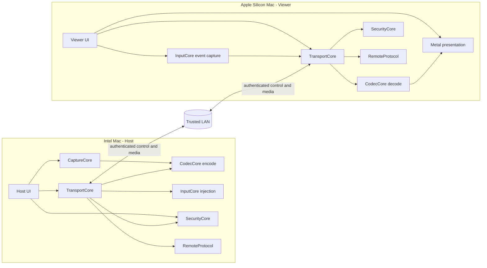

# MacRemoteApp Architecture

## Architecture intent

MacRemoteApp is a two-application system with shared, platform-aware packages.
The architecture keeps capture, codec, transport, input, security, and wire
protocol concerns separate so that the Host and Viewer can evolve without
turning into one coupled remote-desktop process.

The architecture is intentionally limited to the V1 goal: one authenticated
Viewer, one selected Host window, LAN transport, low-latency video, input, and
text clipboard. It does not design an Internet relay, WebRTC, audio pipeline,
file transfer, or multi-window control path.

## Logical topology



The diagram is logical, not a requirement that every package be a separate
process. Host and Viewer are the process boundaries; shared packages are
library/module boundaries.

## Repository structure

```text
MacRemoteApp/
├── Apps/
│   ├── Host/
│   └── Viewer/
├── Packages/
│   ├── RemoteProtocol/
│   ├── CaptureCore/
│   ├── CodecCore/
│   ├── TransportCore/
│   ├── InputCore/
│   └── SecurityCore/
├── Tests/
└── docs/
```

M0 may create a minimal variation of this layout if the selected Swift/Xcode
project format needs it, but any variation must preserve the package
responsibilities and dependency direction below.

## Component responsibilities

| Component | Owns | Does not own |
| --- | --- | --- |
| `Apps/Host` | Host UI, lifecycle, permission education, window-selection UX, composition of Host packages | Wire framing, codec internals, generic transport policy |
| `Apps/Viewer` | Viewer UI, discovery/session UX, stream surface, input surface, clipboard consent UI | Host capture, Accessibility injection, trust-store internals |
| `RemoteProtocol` | Versioned wire messages, frame envelope, serialization/deserialization, capability identifiers, validation limits | Sockets, UI, ScreenCaptureKit, VideoToolbox, Keychain |
| `CaptureCore` | Host-side application/window enumeration and ScreenCaptureKit capture orchestration, timestamps, capture state | H.264 bitstream policy, network I/O, remote input |
| `CodecCore` | VideoToolbox compression/decompression adapters, codec configuration, frame metadata, decode output contract | Window selection, transport, user permissions |
| `TransportCore` | Bonjour discovery, Network.framework connections, channel lifecycle, framing delivery, bounded queues, flow control, reconnect state, and session authorization delivery gates | Product UI, pairing policy, capture, event injection, current macOS permission/focus truth |
| `InputCore` | Platform-neutral input model, Viewer event normalization, Host coordinate mapping, permission-aware injection adapter contract and final injection-time safety check | Wire serialization, trust decisions, arbitrary background control |
| `SecurityCore` | Device identity, Keychain trust records, pairing state, peer authentication policy, reusable trust/capability policy evaluation, redaction helpers | UI prompts, sockets, window selection, current window/permission/focus state, generic business workflow |

## Dependency direction

The intended dependency direction is:

```text
Apps/Host ───────┐
Apps/Viewer ─────┼──> RemoteProtocol
                 ├──> TransportCore ───> RemoteProtocol
                 ├──> SecurityCore
                 ├──> InputCore
                 ├──> CodecCore
                 └──> CaptureCore (Host only)
```

Additional rules:

- `RemoteProtocol` is the lowest-level shared contract and should remain
  independent of AppKit and platform UI.
- `CodecCore`, `CaptureCore`, and `InputCore` may expose protocols for test
  doubles, but they must not reach into each other's concrete implementations.
- `TransportCore` depends on protocol definitions and security/session
  decisions, but `SecurityCore` must not depend on an active socket.
- App modules translate package events into UI state; package modules do not
  import app view controllers.
- `SecurityCore` evaluates identity, pairing consent, trust, and capability
  policy inputs but does not own session-specific window generations or OS
  permission/focus state.
- `TransportCore` is the authoritative session-delivery gate: after TLS and
  pairing policy are satisfied, it stores the current authorization record and
  checks message direction, negotiated capability, session generation, and
  selected-window generation before sending or accepting protected messages.
  It clears that record before teardown or revoke notification and fails closed
  if notification delivery fails.
- `Apps/Host` supplies the selected-window and permission/focus facts.
  `InputCore.HostInputController` performs the final check immediately before
  every Host-side injection; a TransportCore authorization decision alone
  never authorizes an OS event.
- In M3, `CaptureCore` is the source of truth for the Host window catalog,
  Screen Recording permission state, selected-window generation, and raw
  timestamped pixel-buffer lifecycle. `Apps/Host` may map those values to
  `RemoteProtocol` messages after TransportCore authorization; CaptureCore
  itself does not import the wire package.
- In M5, `Apps/Viewer/ViewerInputSurface` owns AppKit event capture and visible
  readiness state. `InputCore` owns the platform-neutral event record,
  coordinate normalization, sequence, and rate/size validation. The Viewer
  maps that record to `RemoteProtocol.InputEventMessage` through
  `ViewerInputTransport`, and `TransportCore.SessionCoordinator` is the
  authenticated capability/window-generation delivery gate. No M5 component
  calls CoreGraphics or Accessibility APIs.
- In M6, `Apps/Host/HostInputMessageHandler` maps the authenticated input
  message to an `InputCore.InputEventRecord`. `InputCore.HostInputController`
  rechecks session/window/capability facts and asks the
  `CoreGraphicsAccessibilityContextProvider` for current permission and
  foreground identity and current geometry before calling the typed
  `CoreGraphicsAccessibilityInputAdapter`. Each command carries the selected
  window identity, owning application identifier, and generation, and the
  adapter repeats that target/focus/owning-application check immediately before
  target-bound process posting. `HostInputSessionLoop` is the single-consumer
  stream dispatcher: it forwards non-input messages to the app dispatcher
  instead of dropping them. The adapter is the only M6 code that
  constructs/posts `CGEvent` values; it never activates background windows.
  `TransportCore.SessionCoordinator.withIncomingInputAdmission` keeps an input
  already delivered directly to the stream waiter in the same non-reentrant
  authorization fence as local revoke, reconnect, and stop transitions.
  `HostInputSessionRuntime`, started by the Host app's per-session composition
  entry point, owns the loop lifetime and resets it on authorization/reconnect
  transitions. Host lifecycle code uses `withSelectionReplacement()` (or pairs
  `selectionWillChange()`/`selectionDidChange()`) while changing CaptureCore's
  selected-window provider; the admission barrier remains held until the
  replacement is published. The loop has a polling
  backstop and closes the session if a missed transition cannot safely release
  the old target. Unknown secure-input or console state remains fail-closed,
  and controller-owned state releases retain a restricted target-bound path
  after authorization loss or a known focus loss. A local selection
  transition should be announced before the provider changes; if it is missed,
  the provider must still be able to identify the old target for a safe release
  or the session is closed. Permission loss leaves cleanup pending and visible
  as unavailable until a safe snapshot permits retry. Local safety transitions also discard queued input messages, and a
  stream-ending runtime retains a target-bound cleanup retry until safe
  target-bound recovery, even when the runtime handle is released. If
  CaptureCore has already published a replacement selection, the provider
  supplies a live release context for the originally admitted target; the new
  selection is never reused to release old state. Lifecycle stop/replacement
  waits for that safe recovery before a replacement Host session can reuse the
  selected target. A permission/focus outage can therefore temporarily block
  reconnection; cancelling the cleanup lease could leave an OS key/button
  pressed indefinitely.
- The physical M2 diagnostic orchestration remains in `Apps/Host` and
  `Apps/Viewer`; `TransportCore` only exposes the Bonjour/TLS/session APIs.
  `SecurityCore.PublicCertificateIdentity` derives a pinned peer identity from
  a public DER certificate, while each app imports its own private PKCS#12
  identity. This keeps certificate provisioning and private-key handling out
  of the transport package and prevents the cross-machine test from copying
  private keys between devices.
- Cross-cutting diagnostics use a narrow structured logging interface. They do
  not pass raw clipboard text, secrets, or full captured frames.

## Host architecture

### Host UI and lifecycle

The Host owns the permission education flow, local window chooser, pairing
confirmation, session status, selected-window state, and stop/disconnect
actions. It is the only component allowed to decide which local window becomes
the selected window, subject to the product and security rules.

### Capture path

`CaptureCore` requests the smallest permitted ScreenCaptureKit capture scope:
the selected window rather than the whole display. It emits timestamped pixel
frames and capture-state transitions. It must stop or degrade safely when the
window disappears, the permission is revoked, or the selected window becomes
ineligible.

### Encode path

`CodecCore` wraps VideoToolbox. It receives frames from `CaptureCore`, applies
the negotiated dimensions/rate-control settings, and emits H.264 access units
with keyframe and timestamp metadata. It owns no socket or session identity.

### Host input path

`InputCore` validates the Viewer event model, maps normalized Viewer
coordinates to the selected window's current geometry, and invokes a
permission-aware CoreGraphics/Accessibility adapter. It must fail closed when
the selected window is no longer eligible or foreground-controlled.

## Viewer architecture

### Viewer UI and session state

The Viewer owns discovery results, pairing UX, session state, stream status,
input enablement, clipboard consent, and errors. The UI must distinguish
"connected but input disabled" from "fully authorized and controllable".

### Decode and presentation path

`CodecCore` wraps the VideoToolbox decoder and emits decoded frames to a
presentation contract. The Viewer composes that contract with a Metal-backed
surface, preserving aspect ratio and reporting the presentation timestamp used
for latency measurement.

### Viewer input path

`InputCore` captures events only inside the remote-content surface, normalizes
coordinates against the displayed content rectangle, preserves key/modifier
ordering, and submits events through `TransportCore`. Local UI shortcuts that
must not be forwarded remain owned by the Viewer.

## Shared runtime model

Swift 6 strict concurrency is the baseline. The implementation should use
actors or other explicit isolation for mutable session state rather than
sharing mutable state across capture, transport, codec, and UI callbacks.

The intended ownership is:

- `HostSession` / `ViewerSession` actor: authenticated session state,
  authorization, capability negotiation, and lifecycle transitions.
- Capture/codec pipeline isolation: bounded frame handoff and cancellation.
- Transport isolation: connection callbacks, frame parsing, send queues, and
  reconnect state.
- UI main actor: user-facing state and platform UI.

No pipeline may create an unbounded queue. Cancellation must propagate when a
session ends, a selected window changes, or a permission becomes invalid.

## Control plane and media plane

The control plane carries discovery results, handshake, capabilities, window
lists, selected-window state, session status, input events, clipboard messages,
and errors. It is reliable and ordered.

The media plane carries codec configuration and video frames. It has an
independent bounded scheduling queue and may replace only unsent, discardable
video frames before they are admitted to the wire. `VideoConfig` and
recovery keyframes are not discardable. Media sequences are strictly
increasing, but a replaced frame may create a forward media gap; control
sequences remain contiguous. The baseline V1 binding is one ordered
Network.framework TCP stream protected by the same authenticated session
policy; control is prioritized between individual writes, while TCP
head-of-line blocking remains an M8 measurement concern. M8 may evaluate a
different Network.framework binding only if the measured baseline misses the
documented target. WebRTC is not a V1 option.

The protocol envelope is shared, but the media plane must not be allowed to
block control/input progress indefinitely.

## Session lifecycle

```text
Discovered
  -> Connecting
  -> TLS/peer authentication
  -> Pairing required OR Trusted
  -> Capabilities negotiated
  -> Window selection authorized
  -> Streaming + input eligible
  -> Stopping / Reconnecting / Failed
```

Every transition is explicit and observable. A reconnect never silently
restores input authority; it must revalidate trust, session authorization,
selected-window identity, and permission state.

## Platform and hardware boundaries

- Intel Host and Apple Silicon Viewer are intentional V1 targets; the
  architecture must not assume identical CPU/GPU characteristics.
- The Host executable is validated for both `x86_64` and `arm64` builds for
  development and packaging portability; this does not change the V1 physical
  integration target of an Intel Host.
- H.264 is the V1 interoperability baseline. HEVC or other codecs are not
  added as speculative features.
- Screen Recording and Accessibility permissions are Host capabilities and are
  surfaced by the Host UI; packages must return structured permission states.
- The exact macOS deployment target is an M0 decision and must be tested on
  both target architectures where possible.
- All platform-specific APIs live behind package adapters so protocol and
  session tests can run without a live capture window or Accessibility grant.

## Failure and backpressure principles

- Prefer a recent video frame over an old frame when the Viewer is behind.
- Never allow a slow network to grow capture or encode memory without bound.
- Preserve ordering and delivery for input and control messages.
- Treat malformed, oversized, out-of-order, or unsupported messages as
  protocol errors; do not attempt to guess their meaning.
- Authorization-epoch invalidation drops queued protected media and converts
  queued protected control payloads to optional unknown tombstones with their
  original sequence, preserving strict ordering without applying stale window,
  input, or session data.
- Stop input first when session health or authorization becomes uncertain.
- Surface enough state for the Operator to recover without exposing sensitive
  diagnostics.

## Architecture decisions to record during implementation

M0-M2 must record the selected Swift/Xcode project format, deployment target,
Bonjour service identity, TLS/certificate strategy, and stream connection
binding. M4 must record H.264 profile and rate-control defaults. M7 must record
clipboard conflict and size policy. M8 must record benchmark evidence before
any performance-driven transport change. These are decisions, not permission
to add speculative features.

## M2 decisions

- Bonjour uses `_macremote._tcp` in `local.`. Discovery results are treated as
  untrusted endpoint hints and contain no pairing secret or captured content.
- The initial connection binding is one ordered Network.framework TCP byte
  stream carrying the M1 control/media channels. `TransportCore` keeps bounded
  control and media queues separate so stale media cannot starve control.
- TLS requires version 1.3 or newer and peer authentication on every
  connection. `SecurityCore` identifies a peer by the SHA-256 fingerprint of
  the leaf certificate public-key representation and compares it with a
  Keychain trust record.
- Unknown peers use a certificate-presented bootstrap session followed by
  explicit two-sided local-consent pairing. Trust does not imply window
  authorization; the Host must separately authorize the session after
  capability negotiation.

## M3 decisions

- The Host uses ScreenCaptureKit's desktop-independent-window filter and does
  not fall back to whole-display capture.
- Window discovery requires Screen Recording authorization, an on-screen
  zero-layer window, a non-empty application bundle identifier, and positive
  bounds. Titles remain optional metadata and are not treated as credentials.
- `WindowCaptureSession` assigns a new generation per selection, accepts only
  matching window/generation frames, and uses a bounded newest-frame output.
  Permission loss, window disappearance, capture error, EOF, or cancellation
  invalidates the active capture before later codec or transport work.
