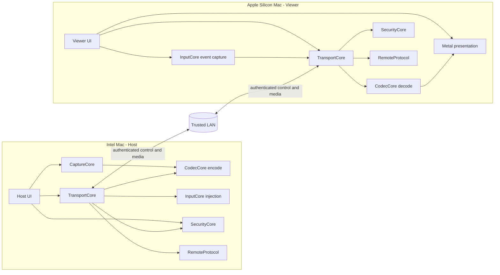

# MacRemoteApp Architecture

## Architecture intent

MacRemoteApp is a two-application system with shared, platform-aware packages.
The architecture keeps capture, codec, transport, input, security, and wire
protocol concerns separate so that the Host and Viewer can evolve without
turning into one coupled remote-desktop process.

The architecture is intentionally limited to the V1 goal: one authenticated
Viewer, one selected Host window, LAN transport, low-latency video, input, and
text clipboard. It does not design an Internet relay, WebRTC, audio pipeline,
file transfer, or multi-window control path.

Post-V1 capability proposals and their security/ownership gates are recorded
in `docs/POST_V1_ROADMAP.md`; they are not architecture commitments for M10.

## Logical topology



The diagram is logical, not a requirement that every package be a separate
process. Host and Viewer are the process boundaries; shared packages are
library/module boundaries.

## Repository structure

```text
MacRemoteApp/
├── Apps/
│   ├── Host/
│   └── Viewer/
├── Packages/
│   ├── AppSupport/
│   ├── RemoteProtocol/
│   ├── CaptureCore/
│   ├── CodecCore/
│   ├── TransportCore/
│   ├── InputCore/
│   └── SecurityCore/
├── Tests/
└── docs/
```

M0 may create a minimal variation of this layout if the selected Swift/Xcode
project format needs it, but any variation must preserve the package
responsibilities and dependency direction below.

## Component responsibilities

| Component | Owns | Does not own |
| --- | --- | --- |
| `Apps/Host` | Host UI, lifecycle, permission education, window-selection UX, composition of Host packages | Wire framing, codec internals, generic transport policy |
| `Apps/Viewer` | Viewer UI, discovery/session UX, stream surface, input surface, clipboard consent UI | Host capture, Accessibility injection, trust-store internals |
| `AppSupport` | Native AppKit menu construction, reusable settings content/window presentation, bundle version/build formatting | Session ownership, permission requests, Keychain access, transport, capture, input authorization |
| `RemoteProtocol` | Versioned wire messages, frame envelope, serialization/deserialization, capability identifiers, validation limits | Sockets, UI, ScreenCaptureKit, VideoToolbox, Keychain |
| `CaptureCore` | Host-side application/window enumeration and ScreenCaptureKit capture orchestration, timestamps, capture state | H.264 bitstream policy, network I/O, remote input |
| `CodecCore` | VideoToolbox compression/decompression adapters, codec configuration, frame metadata, decode output contract | Window selection, transport, user permissions |
| `TransportCore` | Bonjour discovery, Network.framework connections, channel lifecycle, framing delivery, bounded queues, flow control, reconnect state, and session authorization delivery gates | Product UI, pairing policy, capture, event injection, current macOS permission/focus truth |
| `InputCore` | Platform-neutral input model, Viewer event normalization, Host coordinate mapping, permission-aware injection adapter contract and final injection-time safety check | Wire serialization, trust decisions, arbitrary background control |
| `SecurityCore` | Device identity, Keychain trust records, pairing state, peer authentication policy, reusable trust/capability policy evaluation, redaction helpers | UI prompts, sockets, window selection, current window/permission/focus state, generic business workflow |

## Dependency direction

The intended dependency direction is:

```text
Apps/Host ───────┐
Apps/Viewer ─────┼──> RemoteProtocol
                 ├──> TransportCore ───> RemoteProtocol
                 ├──> SecurityCore
                 ├──> InputCore
                 ├──> CodecCore
                 ├──> CaptureCore (Host only)
                 └──> AppSupport (app-layer UI only)
```

Additional rules:

- `RemoteProtocol` is the lowest-level shared contract and should remain
  independent of AppKit and platform UI.
- `CodecCore`, `CaptureCore`, and `InputCore` may expose protocols for test
  doubles, but they must not reach into each other's concrete implementations.
- `TransportCore` depends on protocol definitions and security/session
  decisions, but `SecurityCore` must not depend on an active socket.
- App modules translate package events into UI state; package modules do not
  import app view controllers.
- `AppSupport` is a leaf UI package used by the two app targets. It imports
  AppKit/Foundation, not the protocol, session, or security packages. Core
  packages do not depend on it. App-owned callbacks connect menu/settings
  actions to existing runtime operations.
- `SecurityCore` evaluates identity, pairing consent, trust, and capability
  policy inputs but does not own session-specific window generations or OS
  permission/focus state.
- `TransportCore` is the authoritative session-delivery gate: after TLS and
  pairing policy are satisfied, it stores the current authorization record and
  checks message direction, negotiated capability, session generation, and
  selected-window generation before sending or accepting protected messages.
  It clears that record before teardown or revoke notification and fails closed
  if notification delivery fails.
- `Apps/Host` supplies the selected-window and permission/focus facts.
  `InputCore.HostInputController` performs the final check immediately before
  every Host-side injection; a TransportCore authorization decision alone
  never authorizes an OS event.
- M7 keeps clipboard policy split at the same boundary: `RemoteProtocol` owns
  the bounded Offer/Text/Acknowledgement wire schemas; `TransportCore` owns the
  pure `ClipboardSyncCoordinator` transient state machine and the redacted
  `SessionUXProjection`; `Apps/Host` and `Apps/Viewer` are the only layers that
  read/write `NSPasteboard` and render the opt-in/session status. Clipboard
  AppKit bridges must still call `SessionCoordinator.send`, so
  `TransportCore` remains the authoritative authentication, authorization, and
  capability enforcement point.
- In M3, `CaptureCore` is the source of truth for the Host window catalog,
  Screen Recording permission state, selected-window generation, and raw
  timestamped pixel-buffer lifecycle. `Apps/Host` may map those values to
  `RemoteProtocol` messages after TransportCore authorization; CaptureCore
  itself does not import the wire package.
- In M5, `Apps/Viewer/ViewerInputSurface` owns AppKit event capture and visible
  readiness state. `InputCore` owns the platform-neutral event record,
  coordinate normalization, sequence, and rate/size validation. The Viewer
  maps that record to `RemoteProtocol.InputEventMessage` through
  `ViewerInputTransport`, and `TransportCore.SessionCoordinator` is the
  authenticated capability/window-generation delivery gate. No M5 component
  calls CoreGraphics or Accessibility APIs.
- In M6, `Apps/Host/HostInputMessageHandler` maps the authenticated input
  message to an `InputCore.InputEventRecord`. `InputCore.HostInputController`
  rechecks session/window/capability facts and asks the
  `CoreGraphicsAccessibilityContextProvider` for current permission and
  foreground identity and current geometry before calling the typed
  `CoreGraphicsAccessibilityInputAdapter`. Each command carries the selected
  window identity, owning application identifier, and generation, and the
  adapter repeats that target/focus/owning-application check immediately before
  target-bound process posting. `HostInputSessionLoop` is the single-consumer
  stream dispatcher: it forwards non-input messages to the app dispatcher
  instead of dropping them. The adapter is the only M6 code that
  constructs/posts `CGEvent` values; it never activates background windows.
  `TransportCore.SessionCoordinator.withIncomingInputAdmission` keeps an input
  already delivered directly to the stream waiter in the same non-reentrant
  authorization fence as local revoke, reconnect, and stop transitions.
  `HostInputSessionRuntime`, started by the Host app's per-session composition
  entry point, owns the loop lifetime and resets it on authorization/reconnect
  transitions. Host lifecycle code uses `withSelectionReplacement()` (or pairs
  `selectionWillChange()`/`selectionDidChange()`) while changing CaptureCore's
  selected-window provider; the admission barrier remains held until the
  replacement is published. The loop has a polling
  backstop and closes the session if a missed transition cannot safely release
  the old target. A detected secure-input or unknown console state remains
  fail-closed; an unavailable optional AX secure-input signal does not replace
  the independent foreground/window checks, and controller-owned state
  releases retain a restricted target-bound path
  after authorization loss or a known focus loss. A local selection
  transition should be announced before the provider changes; if it is missed,
  the provider must still be able to identify the old target for a safe release
  or the session is closed. Permission loss leaves cleanup pending and visible
  as unavailable until a safe snapshot permits retry. Local safety transitions also discard queued input messages, and a
  stream-ending runtime retains a target-bound cleanup retry until safe
  target-bound recovery, even when the runtime handle is released. If
  CaptureCore has already published a replacement selection, the provider
  supplies a live release context for the originally admitted target; the new
  selection is never reused to release old state. Lifecycle stop/replacement
  waits for that safe recovery before a replacement Host session can reuse the
  selected target. A permission/focus outage can therefore temporarily block
  reconnection; cancelling the cleanup lease could leave an OS key/button
  pressed indefinitely.
- In M10, `Apps/Host/HostRuntime` composes first-run permission onboarding, the
  listener, `CaptureCore`,
  `CodecCore`, `InputCore`, clipboard bridges, and `SessionCoordinator` for
  one authenticated Viewer. `Apps/Viewer/ViewerRuntime` composes Bonjour
  discovery, the authenticated session, H.264 decode, Metal presentation, the
  Viewer input surface, pairing prompts, and clipboard bridge. The normal
  pilot uses TLS bootstrap plus a `SecurityCore.PairingCoordinator` backed by
  the Keychain trust store; the Host owns the consent alert and the Viewer
  owns a code-comparison consent prompt with explicit Accept/Deny actions.
  `MACREMOTEAPP_PEER_CERT` remains an
  optional pinned-peer migration/diagnostic input, not a new-installation
  requirement. The Host remains authoritative by validating eligibility and
  generation before authorization. During an active session it refreshes the
  eligible-window catalog so the Viewer can replace the selected app without
  reconnecting. A direct Viewer selection may foreground that regular app on
  the Host; this only expresses the user's explicit target choice and does not
  bypass InputCore's per-event permission/focus/identity checks. The Viewer
  shows explicit Connecting, Connected, and Reconnecting states and disables
  duplicate Connect actions while a session is active. Host and Viewer send
  their bounded short hostnames in the optional `Hello.deviceName` display
  field; a Host rename is reflected in that field, and it never affects trust.
  The Host remains resident when TCC or
  Bonjour setup is denied: `HostRuntimeStatus` is projected into the status
  menu and an explicit Retry action re-runs setup. Physical cross-hardware
  evidence remains the open M10 acceptance gate.
- M10 also exposes trust recovery in the app layer without moving trust
  storage out of `SecurityCore`: the Host status menu and Viewer window can
  explicitly forget all saved peer records. The app stops the active session
  before asking the Keychain-backed `TrustStore` to revoke those records; the
  local device identity, permissions, and capture settings remain intact. The
  Host status menu also edits a bounded, UserDefaults-backed Bonjour instance
  name. That name is discovery metadata visible on the LAN, never a TLS or
  pairing identity, and changing it restarts only the listener.
- M10 startup ordering is intentional: `Apps/Host` enrolls the local
  Keychain-backed identity and completes the Screen Recording setup before it
  waits for Bonjour listener readiness. Starting Bonjour is the Local Network
  consent trigger; listener readiness requires both the Network.framework
  socket-ready state and the configured service-registration callback. A
  timeout or policy denial is surfaced as a Local Network recovery state.
  `Apps/Viewer` enrolls its own identity before starting discovery, reports
  discovery error categories, and requires the operator to choose a Host
  before connecting. Neither app treats a permission grant as pairing: the
  first connection still requires Host consent and explicit Viewer acceptance
  after comparing the independently derived code; only both consents commit
  the peer trust records.
- Authorization enforcement is deliberately split by responsibility:
  `SecurityCore` owns identity, trust records, pairing consent, and peer
  identity validation; `TransportCore.SessionCoordinator` owns the
  authenticated session authorization epoch, capability/window-generation
  delivery gate, and protected-message invalidation; `InputCore.HostInputController`
  performs the final per-event permission, focus, target-identity, and current
  geometry checks. `Apps/Host/HostRuntime` composes these gates and never
  replaces them with UI state.
- The physical M2 diagnostic orchestration remains in `Apps/Host` and
  `Apps/Viewer`; `TransportCore` only exposes the Bonjour/TLS/session APIs.
  `SecurityCore` derives the presented peer identity from the TLS public key
  and persists only the trusted peer record. Each app loads or locally enrolls
  its own P-256 private key and certificate in Keychain, then assembles the
  `SecIdentity` used by Network.framework. The debug-only PKCS#12 provisioning
  path remains for physical smoke diagnostics. No peer private key is
  exchanged; the optional public-certificate path is retained only for pinned
  migration and diagnostics.
- The M10 production composition uses separate Keychain namespaces for the
  two roles: Host identity label `MacRemoteApp.host` and trust service
  `com.rudinyu.MacRemoteApp.Host.trust`; Viewer identity label
  `MacRemoteApp.viewer` and trust service
  `com.rudinyu.MacRemoteApp.Viewer.trust`. The legacy
  `MACREMOTEAPP_LOCAL_IDENTITY_LABEL` diagnostic value is treated as a base and
  receives a role suffix, so setting the same base for both apps cannot make
  them load one private key. This also permits same-Mac GUI testing without
  cross-app access to either role's generated identity or peer-trust records.
  Existing pre-isolation trust records are not imported; both endpoints must
  complete pairing once after upgrading. The update leaves legacy Keychain
  records untouched rather than attempting cross-role deletion.
- Cross-cutting diagnostics use a narrow structured logging interface. They do
  not pass raw clipboard text, secrets, or full captured frames.

## Native app shell and release identity

`AppSupport.ApplicationMenu` installs the shared application, File, and Window
menus. About and Settings use app-owned callbacks; Quit goes through
`NSApplication.terminate` and the role's existing asynchronous shutdown
delegate. Close, Minimize, and Zoom use the current window's responder chain.
Services, Hide, Hide Others, Show All, Show App, and Bring All to Front remain
local macOS operations, not remote input commands.

`SettingsView` is reusable, scrollable content with read-only status fields and
explicit action callbacks. `SettingsWindowController` is a retained modeless
window wrapper for Host Settings and both About windows. Viewer Settings embeds
the content directly instead of using that wrapper. About may open a separate
information window; it is not a second Viewer session or Settings window.

`ApplicationMetadata` reads `CFBundleShortVersionString` and `CFBundleVersion`
from the app bundle. The release format is `major.minor.build`, not a semantic
patch counter: short version `0.2` plus build `1003` displays
`0.2.1003 (Build 1003)`. Both role plists must agree. About, Settings, the Viewer
title/status, and Host status menu use this shared formatting. Unbundled
executables report development metadata rather than inventing a release.
The application release identity is separate from the negotiated wire protocol
version; this UI change does not alter the protocol.

## Host architecture

### Host UI and lifecycle

The Host owns the permission education flow, pairing confirmation, session
status, saved-pairing revocation, editable discovery name, selected-window
state, and stop/disconnect actions. The Host remains
resident while first-run permissions are incomplete and exposes a retry action
from its status menu. The Viewer presents explicit Host and eligible-window
pickers, but the Host remains the only component allowed to accept a selection,
replace the selected local window in an authenticated session, and decide which
window becomes selected, subject to the product and security rules.

The Host starts as an accessory/menu-bar app. Opening About or Settings promotes
it to regular activation so the app menu, Dock restoration, and window controls
are available. It returns to accessory mode after both windows close, but not
while either remains minimized. Closing Settings does not terminate the runtime;
Quit still stops the session through the existing delegate.

The app retains one Settings controller and projects `HostRuntimeStatus` and
the configured discovery name into it. Screen Recording, PostEvent, and
optional Accessibility checks are read-only and refresh on activation and
status updates. Bonjour service state is not a Local Network permission
preflight. Rename, Retry setup, Privacy & Security, and confirmed Forget saved
pairings actions reuse the existing app operations; the settings component
does not grant permission or mutate trust independently.

### Capture path

`CaptureCore` requests the smallest permitted ScreenCaptureKit capture scope:
the selected window rather than the whole display. It emits pixel frames with
a Host monotonic capture-arrival timestamp and a separate media presentation
timestamp, plus capture-state transitions. Output is sized in pixels at the
window's display backing scale and fit to the negotiated 1920×1080 cap; the
size is fixed per capture generation. It must stop or degrade safely when
the window disappears, the permission is revoked, or the selected window
becomes ineligible.

### Encode path

`CodecCore` wraps VideoToolbox. It receives frames from `CaptureCore`, applies
the negotiated dimensions/rate-control settings, and emits H.264 access units
with keyframe and timestamp metadata. It owns no socket or session identity.

### Host input path

`InputCore` validates the Viewer event model, maps normalized Viewer
coordinates to the selected window's current geometry, and invokes a
permission-aware CoreGraphics/Accessibility adapter. It must fail closed when
the selected window is no longer eligible or foreground-controlled.

## Viewer architecture

### Viewer UI and session state

The Viewer owns discovery results, pairing UX, session state, stream status,
input enablement, clipboard consent, and errors. The UI must distinguish
"connected but input disabled" from "fully authorized and controllable".

`ViewerRuntime` retains one main `NSWindow`, its `ViewerContentView`, and a
lazily created `SettingsView`. Opening Settings swaps only the window's
`contentView`; the session, decoder, renderer, selected Host/window, and
clipboard bridge remain runtime-owned. Back to Remote View and Command-0
restore the original content and input first responder. `windowShouldClose`
handles Close/Command-W on Settings by returning to the remote view; closing
the remote-view window terminates the Viewer. This is navigation, not a second
connection or a disconnect/reconnect operation.

Removing the input surface from the window uses its existing
`viewWillMove(toWindow:)` release path to release held keys/buttons. Settings
interactions are local; restoring the view does not bypass input readiness or
Host-side authorization checks. Connected switching and safe release still
need two-Mac evidence in [M10 acceptance](M10_ACCEPTANCE.md).

Main-view status updates feed Settings through `settingsValues` and
`onSettingsChange`; discovery state is added by the runtime. The main status
card shows connection state, Host, LAN/TLS, RTT, input readiness, FPS, app
release, and protocol version. Settings shows connection/discovery/input and
clipboard state, plus read-only Host-filter, trust-mode, and reconnect policy.
The clipboard checkbox uses the same session-only opt-in action as the remote
view, not a persistent second preference. Disconnected input reads
`Not connected`; unavailable peer/latency/frame data must not look current.

### Decode and presentation path

`CodecCore` wraps the VideoToolbox decoder and emits decoded frames to a
presentation contract. The Viewer composes that contract with a Metal-backed
surface, preserving aspect ratio. `MetalVideoRenderer` attaches a
`MTLDrawable` presented handler and reports `presentedTime` only after the
drawable reaches the display handoff boundary; queue-entry time is not used as
the display timestamp.

### Viewer input path

`InputCore` captures events only inside the remote-content surface, normalizes
coordinates against the displayed content rectangle, preserves key/modifier
ordering, and submits events through `TransportCore`. Local UI shortcuts that
must not be forwarded remain owned by the Viewer.

## Shared runtime model

Swift 6 strict concurrency is the baseline. The implementation should use
actors or other explicit isolation for mutable session state rather than
sharing mutable state across capture, transport, codec, and UI callbacks.

The intended ownership is:

- `HostSession` / `ViewerSession` actor: authenticated session state,
  authorization, capability negotiation, and lifecycle transitions.
- Capture/codec pipeline isolation: bounded frame handoff and cancellation.
- Transport isolation: connection callbacks, frame parsing, send queues, and
  reconnect state.
- UI main actor: user-facing state and platform UI.

No pipeline may create an unbounded queue. Cancellation must propagate when a
session ends, a selected window changes, or a permission becomes invalid.

## Control plane and media plane

The control plane carries discovery results, handshake, capabilities, window
lists, selected-window state, session status, input events, clipboard messages,
and errors. It is reliable and ordered.

The media plane carries codec configuration and video frames. It has an
independent bounded scheduling queue with a keyframe-aware drop policy:
when full it discards the incoming delta frame, never a queued one, and then
skips every later delta frame until a keyframe, because H.264 delta frames
reference earlier pictures. A keyframe purges queued delta frames it
supersedes. `VideoConfig` and keyframes are never discarded. Media sequences
are strictly increasing, but a discarded frame may create a forward media gap;
control sequences remain contiguous. The baseline V1 binding is one ordered
Network.framework TCP stream protected by the same authenticated session
policy; control is prioritized between individual writes, while TCP
head-of-line blocking remains an M8 measurement concern. M8 may evaluate a
different Network.framework binding only if the measured baseline misses the
documented target. WebRTC is not a V1 option.

The protocol envelope is shared, but the media plane must not be allowed to
block control/input progress indefinitely.

## Session lifecycle

```text
Discovered
  -> Connecting
  -> TLS/peer authentication
  -> Pairing required OR Trusted
  -> Capabilities negotiated
  -> Window selection authorized
  -> Streaming + input eligible
  -> Stopping / Reconnecting / Failed
```

Every transition is explicit and observable. A reconnect never silently
restores input authority; it must revalidate trust, session authorization,
selected-window identity, and permission state.

## Platform and hardware boundaries

- Intel Host and Apple Silicon Viewer are intentional V1 targets; the
  architecture must not assume identical CPU/GPU characteristics.
- The Host executable is validated for both `x86_64` and `arm64` builds for
  development and packaging portability; this does not change the V1 physical
  integration target of an Intel Host.
- H.264 is the V1 interoperability baseline. HEVC or other codecs are not
  added as speculative features.
- Screen Recording and PostEvent permissions are Host capabilities and are
  surfaced by the Host UI; Accessibility is an optional AX/secure-input
  enhancement. Packages must return structured permission states.
- The exact macOS deployment target is an M0 decision and must be tested on
  both target architectures where possible.
- All platform-specific APIs live behind package adapters so protocol and
  session tests can run without a live capture window or Accessibility grant.

## Test-state cleanup boundary

After UI or installation testing, follow [UI Review and Post-test
Cleanup](TESTING_CLEANUP.md). Resolve the exact test bundles and shared
role-state scope first, stop them, invoke each verified app's
`--remove-all-data`, reset only the authorized bundle-specific TCC approvals,
and remove the test installations and dedicated review output. Preserve source,
Git state, other checkouts, and existing release channels. Verify absence
without relaunching the app and recreating its identity/preferences.

This full test reset is distinct from Forget saved pairings, which preserves
the local identity and permissions. Copies with the same role identifiers
share state, so a test reset cannot silently preserve a production copy's
settings. The production DMG uninstaller does not reset TCC; the repository's
legacy `--clean-testing` path is a broader reset and does not replace current
per-role data cleanup. Neither UI code nor AppSupport edits the TCC database.

## Failure and backpressure principles

- Prefer a recent video frame over an old frame when the Viewer is behind.
- Never allow a slow network to grow capture or encode memory without bound.
- Preserve ordering and delivery for input and control messages.
- Treat malformed, oversized, out-of-order, or unsupported messages as
  protocol errors; do not attempt to guess their meaning.
- Authorization-epoch invalidation drops queued protected media and converts
  queued protected control payloads to optional unknown tombstones with their
  original sequence, preserving strict ordering without applying stale window,
  input, or session data.
- Stop input first when session health or authorization becomes uncertain.
- Surface enough state for the Operator to recover without exposing sensitive
  diagnostics.

## Architecture decisions to record during implementation

M0-M2 must record the selected Swift/Xcode project format, deployment target,
Bonjour service identity, TLS/certificate strategy, and stream connection
binding. M4 must record H.264 profile and rate-control defaults. M7 must record
clipboard conflict and size policy. M8 must record benchmark evidence before
any performance-driven transport change. These are decisions, not permission
to add speculative features.

## M8 decisions

- The baseline remains one authenticated Network.framework TCP stream with
  separate bounded control/media queues. No alternate transport is enabled
  without physical evidence that the baseline misses the target.
- The benchmark exchanges at least 20 authenticated four-timestamp probes,
  selects the minimum-RTT offset, reports residual uncertainty and drift, and
  refuses to label one-way latency verified when uncertainty exceeds 5 ms.
- Video queue capacity remains three. The Host outgoing queue and both Viewer
  incoming queues share `KeyframeAwareMediaAdmission`: a discarded delta frame
  starts a skip-until-keyframe state so no delta frame is ever decoded against
  a missing reference, and protected-media invalidation starts the same wait.
  `SessionCoordinator.send` reports `.replacedMedia` only when the queue
  enters that wait (a keyframe purging superseded delta frames does not), and
  the Host forces its next encode to a keyframe. A Viewer-side gap or decode
  failure sends the rate-limited `KeyframeRequest` described in
  `docs/PROTOCOL.md`.
- Encoder output reaches the wire through one FIFO relay
  (`Apps/Host/HostEncodedFrameRelay`) instead of one unstructured task per
  frame, so frames cannot be reordered before sequence numbers are assigned.
  Its bounded buffer follows the same skip-until-keyframe rule on overflow.
- Capture defaults to 4:2:0 bi-planar video-range pixels tagged BT.709, the
  encoder's native input, removing a per-frame BGRA conversion on the Host.
- The p95 latency budget is split per stage in `LatencyBudget.v1`: Host
  capture-to-send 12 ms, network transit 18 ms, Viewer receive-to-present
  20 ms, summing to the 50 ms target. Host and Viewer log sanitized per-stage
  p50/p95 aggregates so a miss can be attributed to one stage.
  Control/input ordering and authorization gates are never traded for a
  latency optimization.
- The encoder disables B-frame reordering and applies a best-effort
  one-second `DataRateLimits` cap at 1.5x the average bitrate. The TCP binding
  sets `noDelay` so small control/input envelopes are not held by Nagle
  coalescing behind video segments.

## M2 decisions

- Bonjour uses `_macremote._tcp` in `local.`. Discovery results are treated as
  untrusted endpoint hints and contain no pairing secret or captured content.
- The initial connection binding is one ordered Network.framework TCP byte
  stream carrying the M1 control/media channels. `TransportCore` keeps bounded
  control and media queues separate so stale media cannot starve control.
- TLS requires version 1.3 or newer and peer authentication on every
  connection. `SecurityCore` identifies a peer by the SHA-256 fingerprint of
  the leaf certificate public-key representation and compares it with a
  Keychain trust record.
- Unknown peers use a certificate-presented bootstrap session followed by
  explicit two-sided local-consent pairing. Trust does not imply window
  authorization; the Host must separately authorize the session after
  capability negotiation.
- A matching local trust record auto-consents to the bootstrap challenge and
  suppresses that endpoint's prompt, but the Host still sends the challenge and
  both consent messages must complete. This keeps one-sided Keychain state from
  deadlocking or silently bypassing consent on the endpoint that needs repair.

## M3 decisions

- The Host uses ScreenCaptureKit's desktop-independent-window filter and does
  not fall back to whole-display capture.
- Window discovery requires Screen Recording authorization, an on-screen
  zero-layer window, a non-empty application bundle identifier, and positive
  bounds. Titles remain optional metadata and are not treated as credentials.
- `WindowCaptureSession` assigns a new generation per selection, accepts only
  matching window/generation frames, and uses a bounded newest-frame output.
  Permission loss, window disappearance, capture error, EOF, or cancellation
  invalidates the active capture before later codec or transport work.
